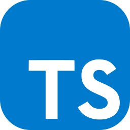
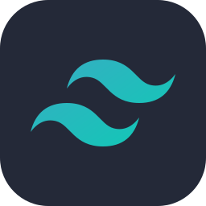
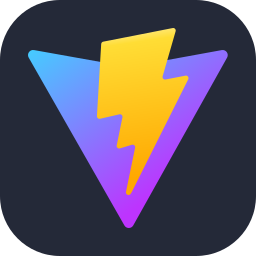
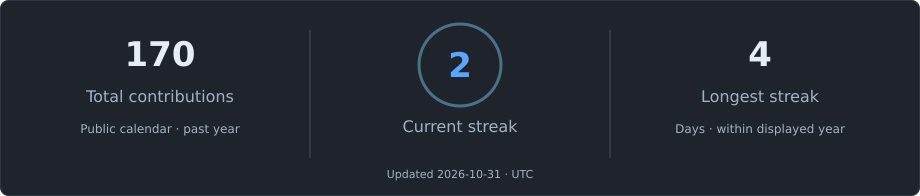
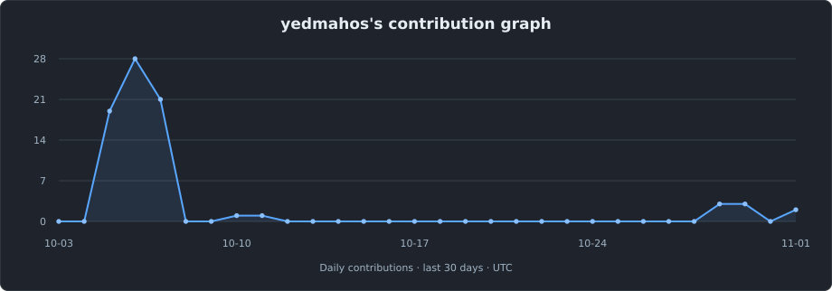
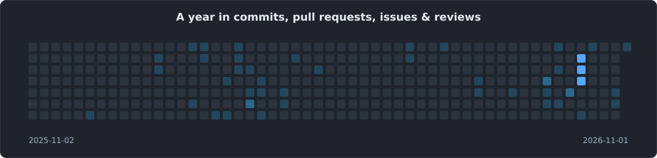

  

<h1 align="center">Hi , I'm Soham</h1>

<h3 align="center">Full Stack Developer</h3>

  

Building web applications with React, Next.js, and Node.js.

<h2 align="center"> About Me</h2>

I'm **Soham Dey**, a developer working across web interfaces and backend systems.

My projects include **Dharitri** for cattle welfare, **Exam Portal SE** for academic administration, and **Limitu** for daily budgeting.

I also work on **Trinetraa**, the AML intelligence interface in my SIH repository, and maintain my own **portfolio**.

My stack includes **React, Next.js, TypeScript, Node.js, MongoDB, and Supabase**.

 

<h2 align="center"> Connect</h2>

  
  &nbsp;&nbsp;&nbsp;
  
  &nbsp;&nbsp;&nbsp;
  

<h2 align="center"> Tech Stack</h2>

  
  &nbsp;
  
  &nbsp;
  
  &nbsp;
  
  &nbsp;
  
  &nbsp;
  

  
  &nbsp;
  
  &nbsp;
  
  &nbsp;
  
  &nbsp;
  
  &nbsp;
  

<h2 align="center"> Selected Projects</h2>

<table>
  <tr>
    <td width="50%" valign="top">
      <h3><a href="https://github.com/yedmahos/dharitri">Dharitri</a></h3>
      
Cattle health records, veterinary access, and farm management.

      
Next.js · TypeScript · Supabase

    </td>
    <td width="50%" valign="top">
      <h3><a href="https://github.com/yedmahos/examportal">Exam Portal SE</a></h3>
      
Exam schedules, seat allocations, hall tickets, and academic records.

      
React · Node.js · MongoDB

    </td>
  </tr>
  <tr>
    <td width="50%" valign="top">
      <h3><a href="https://github.com/yedmahos/limitu">Limitu</a></h3>
      
Daily spending limits, budget insights, and spending simulations.

      
React · Vite · Tailwind CSS

    </td>
    <td width="50%" valign="top">
      <h3><a href="https://github.com/yedmahos/sihweb-Main">SIH / Trinetraa</a></h3>
      
An AML investigation interface for transaction networks and incident data.

      
React · TypeScript · Vite

    </td>
  </tr>
  <tr>
    <td colspan="2" align="center">
      <h3><a href="https://github.com/yedmahos/portfolio">Portfolio</a></h3>
      
My projects and web development work in a custom React interface.

      
React · Vite · Framer Motion

    </td>
  </tr>
</table>

<h2 align="center"> GitHub Stats</h2>

  

<h2 align="center"> Activity Graph</h2>

  

<h2 align="center">⌘ Commit Activity</h2>

  

Contribution cards update daily through GitHub Actions.

  
Design credits

  
Layout reference and monochrome artwork: <a href="https://github.com/midnightshady/midnightshady">midnightshady</a>. Technology and social icons: <a href="https://github.com/tandpfun/skill-icons">Skill Icons</a>. Emoji graphics: <a href="https://github.com/jdecked/twemoji">Twemoji</a> (<a href="https://creativecommons.org/licenses/by/4.0/">CC BY 4.0</a>). Contribution cards are generated from my public GitHub calendar.

